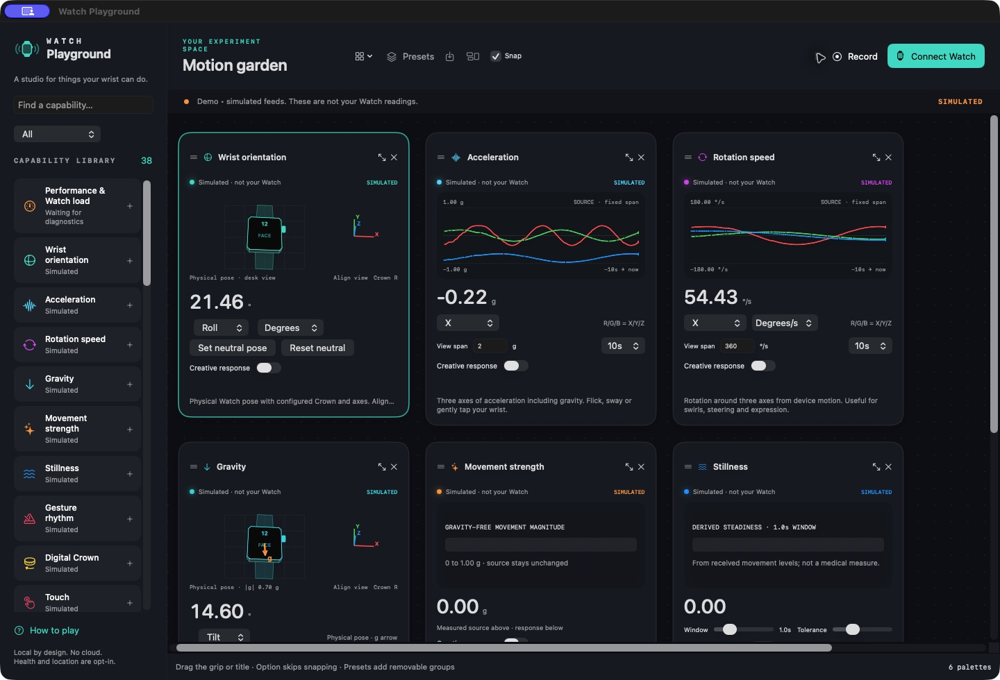
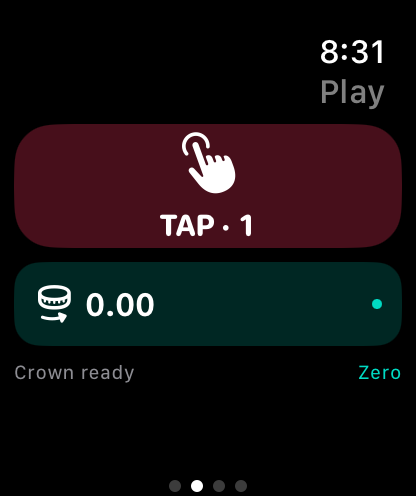

# Apple Watch Playground

**Explore what your Watch can sense—and turn it into something creative.**

A native macOS canvas and Apple Watch app for experimenting with movement, sound levels, touch, the Digital Crown, and other available signals. Arrange live cards, adjust their creative responses, and try ideas such as conducting a metronome with your wrist.

**Experimental · source release · MIT licensed.** The Mac app supports a simulated demo without a Watch. Real Watch use currently requires building and signing the Watch app in Xcode. There is no TestFlight, App Store listing, or notarized binary release yet.



*The Mac screenshots use explicitly labeled simulated signals. They contain no personal sensor recordings.*

## What you can do

- Build a canvas from movable, snappable cards. Drag the title/grip; hold Option to bypass snapping; use arrow keys for precise moves.
- Add or remove seven preset groups: Motion garden, Conductor, Control desk, Sound playground, Body & environment, Saved Health, and Diagnostics. Save your own groups and workspaces.
- View physical orientation with a Crown-matched Watch model, a gravity vector, timed motion traces, microphone level, heading, location, battery, and more.
- Map a signal through adjustable ranges, curves, smoothing, deadbands and thresholds. The measured source stays separate from the creative response.
- Drive a local metronome, trigger Mac sound, and request Watch haptics or display colors.
- Inspect capture, sending, receiving, display cadence, source freshness, and app resource usage separately.
- Export source readings locally as CSV.

The capability library has **38 entries**. These include **20 implemented numeric feed routes**, outputs, saved records, and clearly labeled reference or restricted capabilities. A library entry does not mean every Watch exposes a live signal.

<table><tr><td></td><td>The Watch has Session, Play, Feeds, and Diagnostics pages. Touch and Crown have dedicated controls; permission-dependent feeds are opt-in. Watch-local haptic, sound, and color tests work without the Mac.</td></tr></table>

## What is in this repository?

| Platform | Project | Purpose |
|---|---|---|
| macOS | `Package.swift`, `Sources/WatchPlayground` | Main canvas, instruments, presets, and receiver |
| watchOS | `WatchCompanion/WatchPlayground.xcodeproj`, scheme `WatchPlaygroundWatch` | Sensor capture, local controls, outputs, and transport |
| iOS | Same Xcode project, scheme `PlaygroundPhoneProbe` | Optional local-network diagnostic utility; not an iPhone version of the canvas |

Shared wire formats and timing utilities live in the Mac source folder and are also referenced by the Watch target. Keep the repository's folder structure intact.

## Quick start: Mac demo

You need a Mac running **macOS 14 or later** and Xcode/command-line tools with **Swift 6**. This release was built with Xcode 27; older compatible toolchains have not been independently verified.

```sh
git clone https://github.com/juangrukat/apple-watch-playground.git
cd apple-watch-playground
./build-mac.sh
open "Watch Playground.app"
```

On a fresh install the canvas starts with labeled simulated data. No Apple Watch is needed to explore the instruments and presets. To return to simulated data later, use **Connect Watch → Explore with simulated feeds**.

The local build script signs with an available Apple Development identity or an ad-hoc signature. That is for local development; it is not a notarized public distribution build.

## Connect a real Watch

1. Open `WatchCompanion/WatchPlayground.xcodeproj` in Xcode.
2. Select the **WatchPlaygroundWatch** target, choose your own signing team, and use a unique bundle identifier. The checked-in identifiers use `com.example.watchplayground`; they are placeholders.
3. Connect/unlock the iPhone paired with your Watch, enable the required Developer Mode settings, select your Watch as the run destination, and build/run. Signing/provisioning must support the target's HealthKit capability. See [setup details](docs/SETUP.md).
4. Open the Mac app, choose **Connect Watch → Direct Bluetooth**, and note its six-digit pairing code.
5. On the Watch, open **Playground → Connection setup**, enter that code, and select **Direct Bluetooth**.
6. Enable microphone/location on the Watch only when wanted. Request saved Health records separately and respond to the system permissions.

The Mac does not need the iPhone diagnostic utility for normal Bluetooth operation. Physical testing has focused on an Apple Watch Series 10 GPS running watchOS 26.6; behavior on other models needs testing. The Watch target's declared deployment minimum is watchOS 10, which is not a claim of hardware coverage.

For the pose view, **Align view** changes viewing direction while preserving physical tilt. **Set neutral pose** zeros the numeric orientation and response only.

## Connections, privacy, and limits

Direct Bluetooth uses the Watch as central and the Mac as peripheral. A slower local HTTP route is also available. WatchOS selects the actual route for HTTP; selecting it does not force the Wi-Fi radio. Use a trusted private network that permits communication between devices.

- The app has no analytics or cloud upload service. Signals go to your paired Mac. Local recordings are exported only when you record/export.
- Microphone monitoring sends RMS level, not audio recordings.
- Health cards show the latest authorized **saved** records, not continuous raw biometric streams.
- Location quality and heading accuracy come from Core Location; missing GPS speed is shown as unavailable, not zero. Indoor GPS and magnetic interference can limit results.
- The HTTP route uses pairing/session tokens **without TLS**. Do not expose its local port 8765 to the internet. It is an experimental local transport, not a hardened server.
- Wrist-down/background continuity depends on watchOS execution rules, permissions, and active services. There is no promise of unlimited background monitoring or guaranteed 100 Hz delivery.
- The rate selector requests 25/50/75/100 Hz; diagnostics report actual rates. Those selections are not performance guarantees.
- The Conductor controls a metronome. It does not time-stretch music files.
- CPU/memory gauges measure the app, not whole-device CPU/GPU headroom.

See [capabilities and limitations](docs/CAPABILITIES.md) and [architecture](docs/ARCHITECTURE.md).

## Tests

```sh
./scripts/check.sh
```

The checks cover model behavior, pose math, unit conversion, presets, bounded history, source timestamps, packet scheduling at minimum Bluetooth payload size, circular compass smoothing, temporary GPS recovery, audio metering and wire codecs. Hardware interaction and Watch permissions still require physical testing.

[Local release validation](docs/VALIDATION.md) records the checks run for this source release.

[CI](.github/workflows/check.yml) builds the Mac app and unsigned Watch/iPhone simulator targets. It does not publish or sign release binaries.

## Contribute

Ideas, bug reports, and hardware results are welcome. Include your Watch model, OS/toolchain versions, connection type, and reproduction steps. Use simulated or redacted evidence; do not attach Health records, precise coordinates, pairing codes, or personal recordings. Read [CONTRIBUTING.md](CONTRIBUTING.md).

Not affiliated with or endorsed by Apple. Apple Watch, macOS, iOS, and watchOS are trademarks of Apple Inc.
